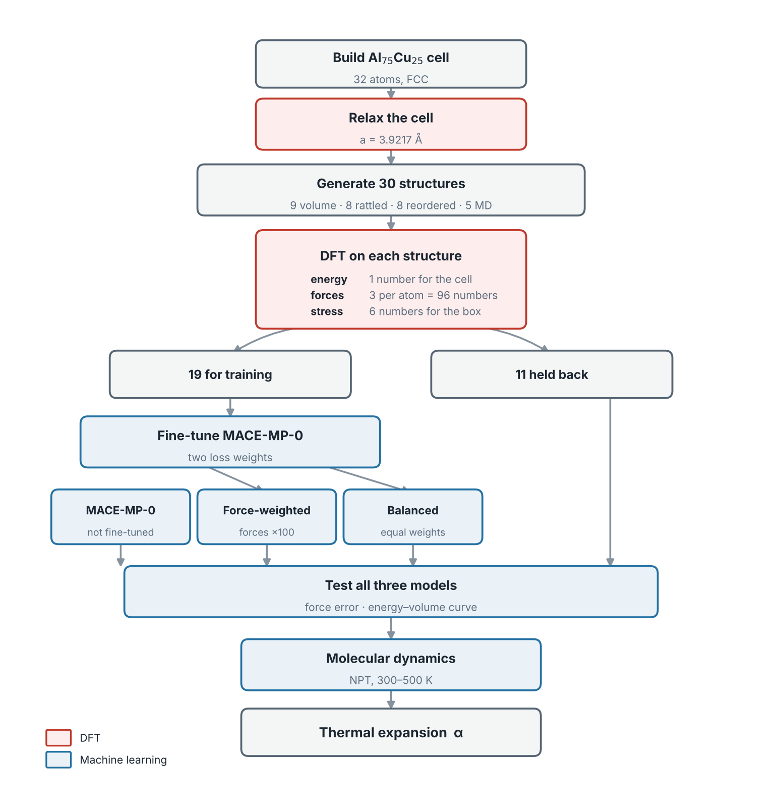
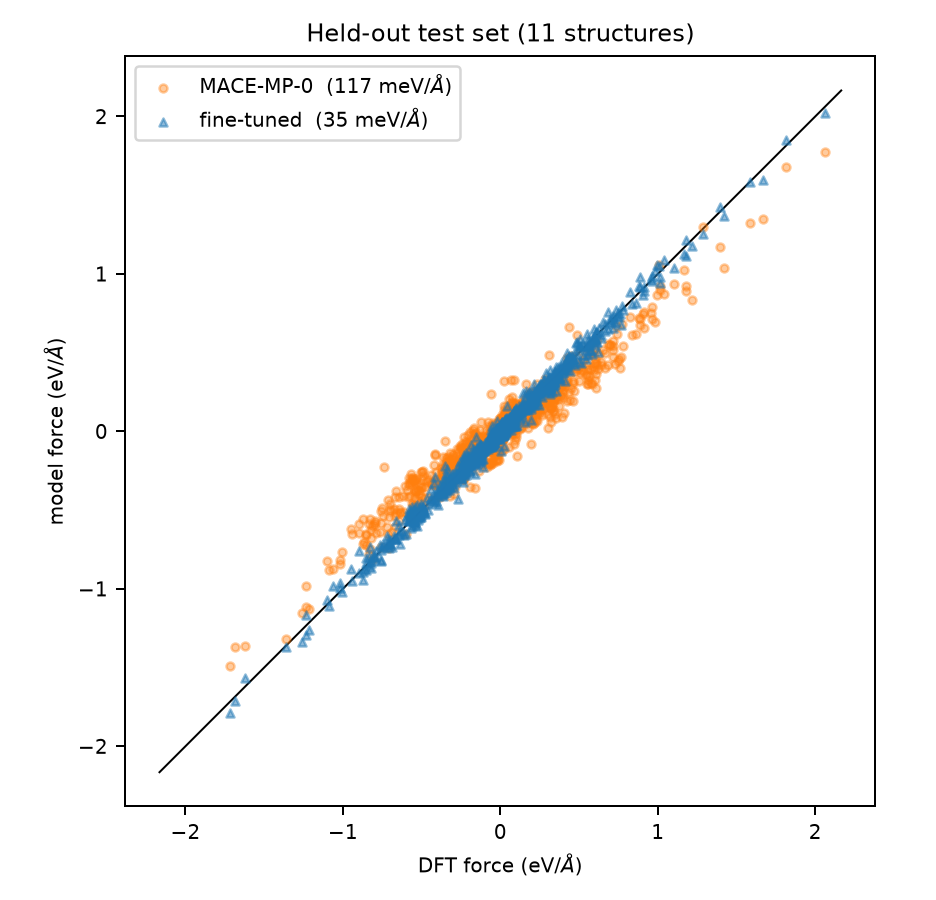
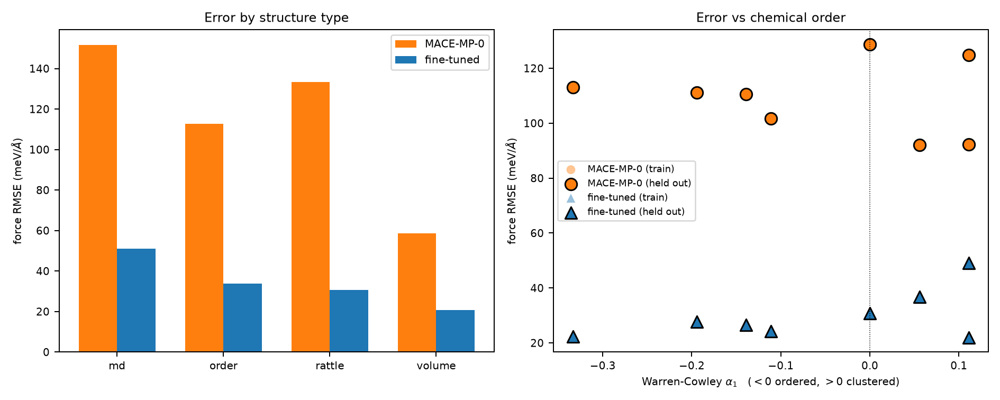
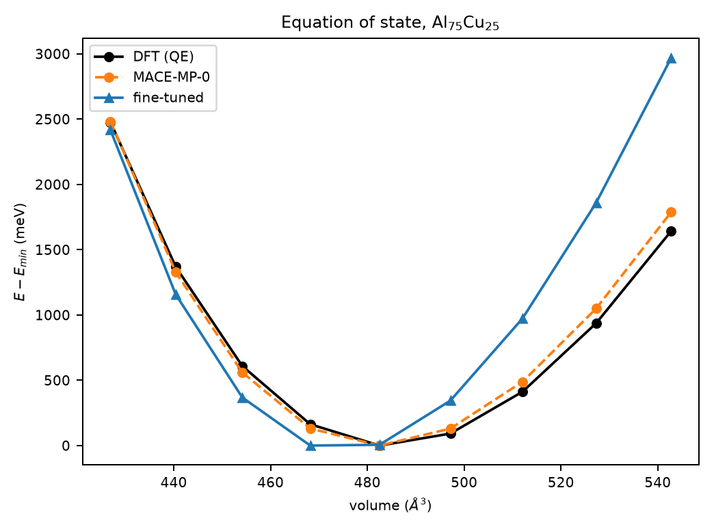
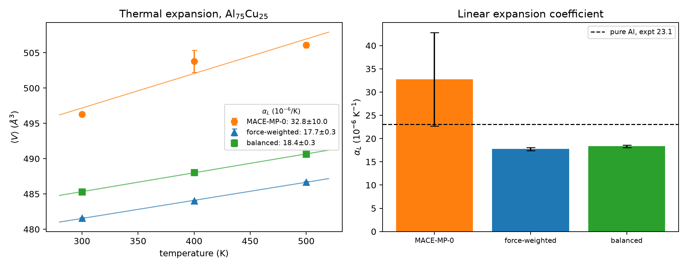

# alcu-mace-finetune

**Fine-tuning MACE-MP-0 on a disordered Al-Cu alloy, and checking whether force error predicts the physics**

## What this is

Molecular dynamics needs the force on every atom at every timestep. DFT gives accurate forces but takes about 8 minutes per snapshot for the cell used here. A machine-learning potential is trained to copy DFT and then does the same job in milliseconds.

MACE-MP-0 is a foundation model, already trained on a large public DFT database, so you can download it and skip training. That database is mostly clean relaxed crystals, and MD does not stay there. So I took a disordered Al₇₅Cu₂₅ cell, ran my own DFT on it, fine-tuned the model, and checked what improved and what did not.

## Results

- The downloaded model's force error grows **2.6×** as structures get messier, 58 to 152 meV/Å.
- Fine-tuning on 19 structures cuts the force error **from 117 to 35 meV/Å**.
- The same fine-tuning makes the energy-volume curve **6.6× worse** and the alloy 26% too stiff.
- Thermal expansion comes out 33, 18 and 18 × 10⁻⁶/K. **Neither accuracy score picks the right one.**
- Two defaults in the standard fine-tuning workflow fail silently.

## Workflow

The relaxed cell is useless for training, because at the bottom of the energy well the forces and stress are both zero. So the 30 structures are made by pushing away from it:

| How many | Distortion | What it teaches |
|---|---|---|
| 9 | Cell scaled ±4% | Stress. The only structures that probe energy against volume. |
| 8 | Atoms displaced 0.05-0.15 Å | Forces. Each atom gets pushed back toward its site. |
| 8 | Cu rearranged, α₁ = −0.333 to +0.111 | Both. Cu is smaller than Al, so moving it changes the strain. |
| 5 | Snapshots from a 500 K run | Both, and large. This is what MD looks like. |

**Note on the composition.** Cu dissolves in Al only up to about 2.5 at% before it precipitates as Al₂Cu [5]. I used 25 at%, so this alloy cannot be made in a furnace. I picked it before checking the phase diagram. The cost is that there is no experimental value to compare against, so every comparison here is model against DFT.

## Force error

*Figure 1*: Each point is one force component on one atom. DFT on x, model on y.

| Structure type | Downloaded | Fine-tuned |
|---|---|---|
| Cell scaled ±4% | 58.5 | 19.3 |
| Cu rearranged | 112.6 | 40.2 |
| Atoms displaced | 133.4 | 30.5 |
| MD snapshots | 151.5 | 53.6 |
| **All 11 test structures** | **116.7** | **34.7** |

Scaled cells keep every atom on a perfect lattice site, which is what the database looks like, and the downloaded model does best there. Hot MD snapshots are furthest from that and it does worst. Fine-tuning improves every category.

*Figure 2*: (left) Error by structure type. (right) Error against the Warren-Cowley parameter, which measures how mixed up the Cu is. Flat for both models, so ordering does not affect accuracy.

## Energy-volume curve

*Figure 3*: Energy against cell volume, each curve shifted to its own minimum.

| Model | Volume error | Bulk modulus |
|---|---|---|
| MACE-MP-0, downloaded | −0.28% | 99.4 GPa |
| Fine-tuned, force-weighted | −1.85% | 121.8 GPa |
| Fine-tuned, balanced | −1.21% | 116.1 GPa |
| DFT (target) | 489.00 ų | 96.4 GPa |

Fine-tuning made this worse, and not by extrapolating. The curve uses the same scaled structures as training, and six of the nine were in the training set. The model got worse on volumes it had already seen. The likely cause is the loss weighting, since an energy-volume curve is pure energy and the first run told the optimiser that forces matter 100 times more. Equal weights recovered about a third and no more.

## Thermal expansion

*Figure 4*: (left) Mean volume against temperature. (right) The fitted coefficient.

| Model | V at 300 K | 400 K | 500 K | α (10⁻⁶/K) |
|---|---|---|---|---|
| MACE-MP-0, downloaded | 496.3 | 503.8 | 506.1 | 32.8 ± 10.0 |
| Fine-tuned, force-weighted | 481.6 | 484.0 | 486.7 | 17.7 ± 0.3 |
| Fine-tuned, balanced | 485.3 | 488.0 | 490.7 | 18.4 ± 0.3 |

The model with the best energy-volume curve gave the answer I trust least. Its volumes do not fall on a line, 7.5 ų from 300 to 400 K and then only 2.3 ų, and the ±10.0 says the same thing. That value is unresolved, not wrong.

**Why.** In NPT the volume fluctuates, and the fluctuation scales as kTV/B. A softer material fluctuates more, so it needs a longer run before the average settles. The downloaded model is softer (99.4 GPa against DFT's 96.4) because it is more accurate, and its volume spread at 300 K is 5.38 ų against the fine-tuned model's 3.36. So the better model needed the longer run, and the stiffer wrong model looked beautifully converged. A tight error bar can mean a converged simulation or just a stiff model.

The two fine-tuned models agree within about 2 standard deviations, so 17-18 × 10⁻⁶/K is a real prediction and not an artefact of the weighting.

## Two silent failures

**Wrong energy reference.** Quantum ESPRESSO reports total energies near −1128 eV/atom and MACE uses a different reference, so `--E0s=foundation` asked the network to learn a constant offset of 1124 eV/atom. Over 120 epochs the energy error fell 75% while the force error rose from 112 to 21,674 meV/Å. The total loss went down the whole time, so the log looked fine. Setting the reference from the training data fixed it completely.

**Multi-head fine-tuning is on by default.** It replays the foundation dataset while training, which is what stops the model forgetting. On this laptop it took the epoch time from 8 seconds to 90 minutes. Switching it off made training take 16 minutes and shifted the predicted pure-Al lattice constant by 78 mÅ. The trade-off should be made on purpose.

## Limitations

- 32 atoms is small, and 8 Cu atoms is coarse for studying ordering.
- 20 ps is short. The non-linear V(T) is the evidence. This is the weakest part.
- One trajectory per temperature. Three shorter independent runs would say more.
- Stress error was never computed, even though the labels are in `data/data_labelled.xyz`.
- No cutoff convergence study. I used 45/360 Ry for speed; SSSP suggests about 55/440 Ry for Cu [4].
- Classical atoms, and Al's Debye temperature of 428 K sits inside the temperature range.
- 19 training structures at one composition, and no experimental reference.

## Conclusions

1. **A foundation model degrades predictably.** Force error rises from 58 to 152 meV/Å as structures move from clean scaled cells to hot MD snapshots, tracking how far each structure sits from what the training database contains.

2. **Fine-tuning on 19 structures improves forces 3.4×,** and every structure type improves by a similar amount. A small amount of purpose-made DFT goes a long way.

3. **The same fine-tuning breaks the energy-volume curve,** 6.6× worse and 26% too stiff, on volumes the model had already trained on. Improving one derivative of the energy does not improve the others.

4. **Force error did not predict the physics, and neither did the energy-volume curve.** The three models were ranked in opposite orders by the two scores, and the thermal expansion coefficient agreed with neither.

5. **The reason is that the expansion result was limited by sampling, not by model error.** The more accurate model had the softer and more correct bulk modulus, which made its volume fluctuate 60% more and left 20 ps too short to converge. A tight error bar can mean a well-sampled run, or an artificially stiff model.

6. **So validate on the derivative that matches the property,** which here would have been stress, and use the error bar on the observable itself, rather than the error bar on forces, to decide whether the number can be trusted.

## Next

Run 100 ps per temperature, or three independent 30 ps runs, which needs no new DFT. Report stress error. Add more volume structures and widen the range past ±4%. Sweep the loss weighting instead of trying two values. Repeat on a composition that exists so there is experimental data.

## Layout

`scripts/` the nine stages plus three helpers that rebuild the QE files and the workflow figure. `data/` the 30 labelled structures and the train/test split. `dft/` every input and output file, with settings in `dft/README.md`. `pseudos/` the PAW pseudopotentials. `figures/` and `results/` the output.

`data/data_labelled.xyz` is the file worth keeping. It holds 8 hours 40 minutes of DFT and everything else rebuilds from it.

## References

1. I. Batatia et al., MACE: higher order equivariant message passing neural networks, NeurIPS 35 (2022) 11423. https://doi.org/10.48550/arXiv.2206.07697
2. I. Batatia et al., A foundation model for atomistic materials chemistry, arXiv:2401.00096 (2023). https://doi.org/10.48550/arXiv.2401.00096
3. P. Giannozzi et al., Advanced capabilities for materials modelling with Quantum ESPRESSO, J. Phys. Condens. Matter 29 (2017) 465901. https://doi.org/10.1088/1361-648X/aa8f79
4. G. Prandini et al., Precision and efficiency in solid-state pseudopotential calculations, npj Comput. Mater. 4 (2018) 72. https://doi.org/10.1038/s41524-018-0127-2
5. J.L. Murray, The Al−Cu system, Bull. Alloy Phase Diagrams 6 (1985) 86. https://doi.org/10.1007/BF02869224

## Contact

Md Jobayer Aziz, md-jobayer.aziz1@louisiana.edu

## Note

A pilot study, small on purpose. Claude (Anthropic) was used as an assistant for code, analysis and figures. All simulations and conclusions were checked by me.
